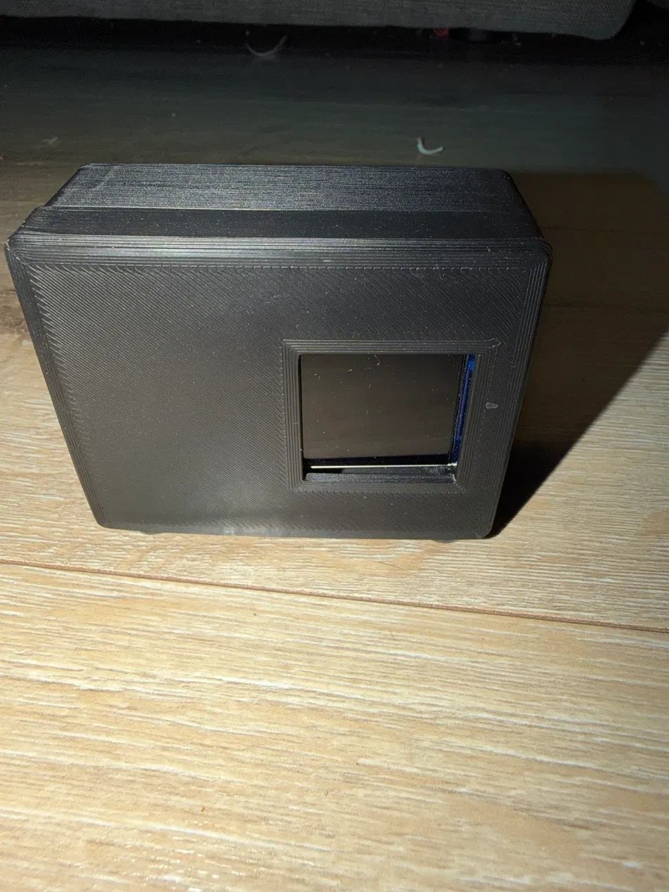
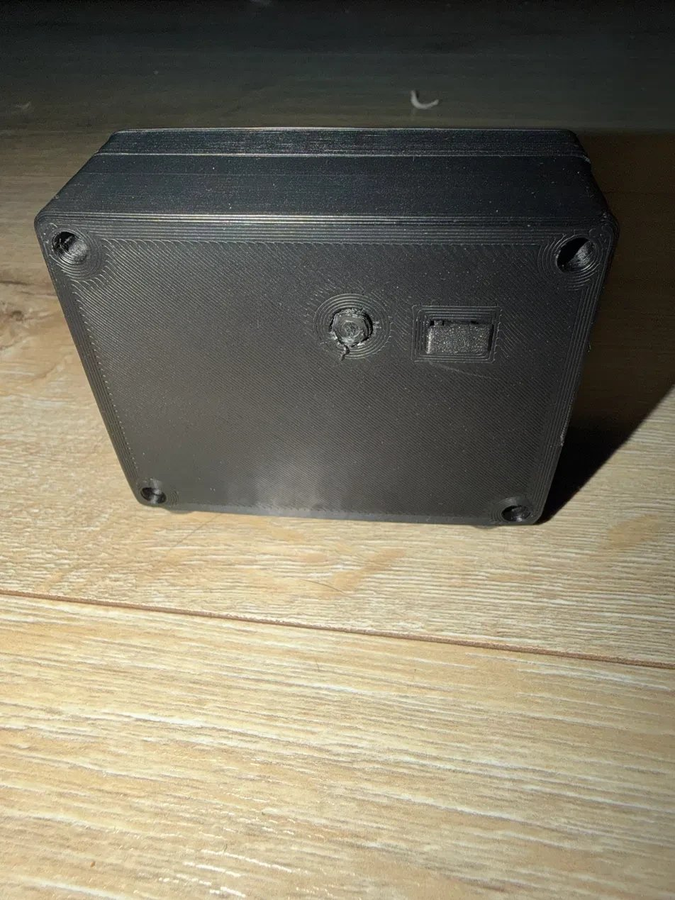
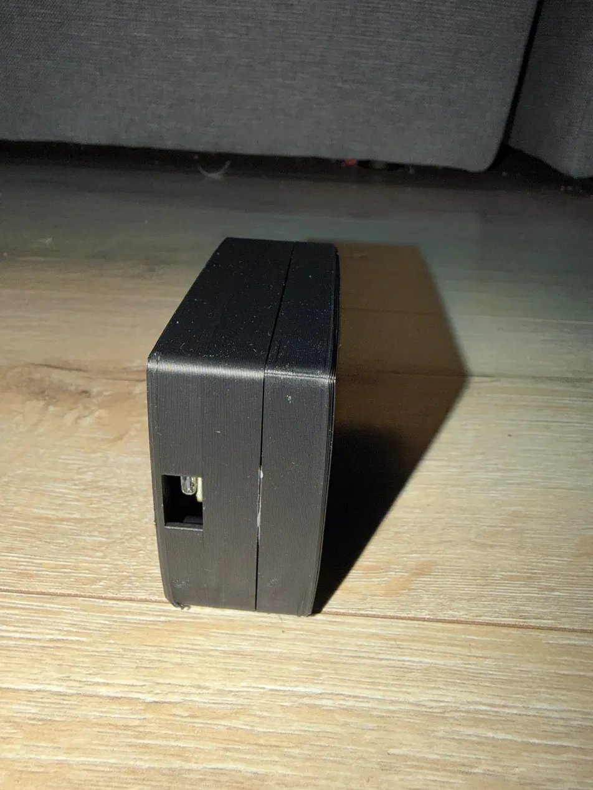
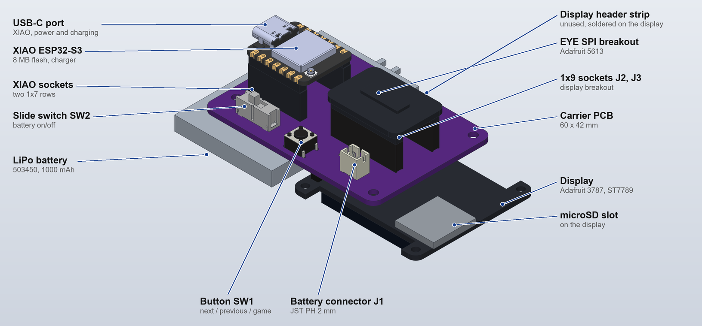
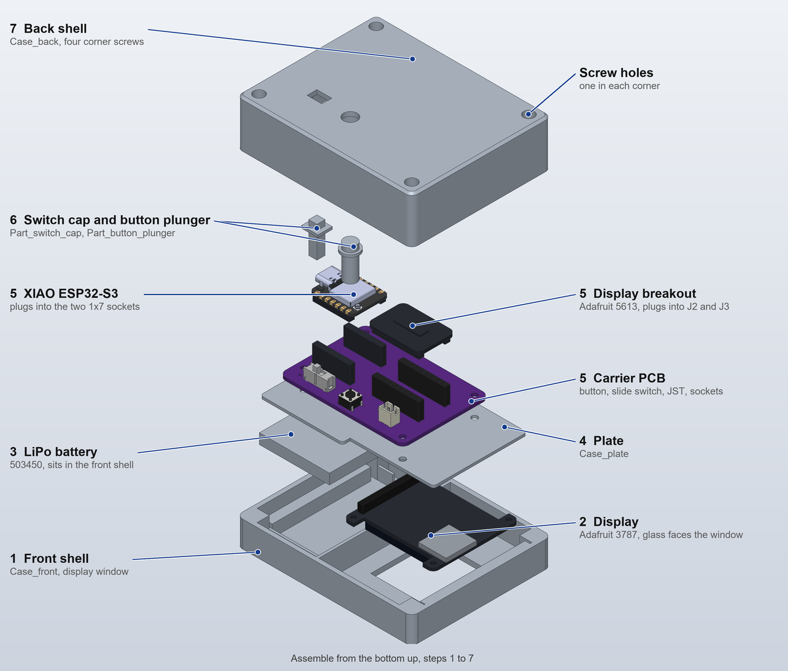

# Digital photo frame

A desk photo frame built around an ESP32-S3 and a 1.54" 240x240 display. It shows photos from flash in random order, shows the time, date and weather, and greets you on birthdays. It runs from USB-C or a LiPo battery and fits in a 3D-printed case. This repository has the PCB, the bill of materials, the firmware and the case files.

| Front | Back | Side |
|---|---|---|
|  |  |  |

Videos: [loading screen](docs/videos/loading-screen.mp4), [game](docs/videos/game.mp4).

## Features

- Photos change every minute, in random order, with transition effects.
- Time and date at the top, weather at the bottom right.
- Birthday greetings: an animated full-screen message on dates you set. The names and dates stay private (see [firmware/README.md](firmware/README.md)).
- Short greetings for morning, afternoon, evening and night.
- One button: press for the next photo, press twice for the previous one, press three times for a game, hold for 5 seconds to restart.
- USB-C power, or a 1000 mAh LiPo that charges over USB-C. A slide switch cuts the battery.
- A microSD slot stores the game high score.

## Use

1. Plug in USB-C, or slide the switch on to run from the battery. A loading screen shows first, then the photos.
2. Use the button as listed above.
3. Wi-Fi sets the clock and gets the weather. It has to be a 2.4 GHz network. Without it the photos still show.
4. To charge, plug in USB-C with the switch on. The XIAO's charge LED lights.
5. To use your own photos, Wi-Fi and birthdays, follow [firmware/README.md](firmware/README.md).

## Parts

The full list with part numbers is in [hardware/bom/BOM.md](hardware/bom/BOM.md).

## Case assembly

Steps are in [docs/assembly.md](docs/assembly.md).

## Repository

| Folder | Contents |
|---|---|
| [hardware/](hardware/) | KiCad project, Gerbers, 3D models, bare and assembled board renders, BOM |
| [firmware/](firmware/) | Arduino sketch, settings templates, photo tools |
| [case/](case/) | STL files and test prints |
| [docs/](docs/) | Assembly and bring-up guide, photo shot list |

## Build it

1. Order the board from `hardware/pcb/fab/jlcpcb_gerbers.zip` and the parts from the BOM.
2. Solder and test it with [docs/assembly.md](docs/assembly.md).
3. Flash the firmware with [firmware/README.md](firmware/README.md).
4. Print the case from [case/stl/](case/stl/).

## Status

The firmware ran on the finished frame. The version here swaps the private photos, stickers, Wi-Fi details, birthday list and location for samples and templates. It compiles with PlatformIO, but that exact version has not been flashed.

## Credits and licence

Display and breakout by Adafruit, XIAO by Seeed Studio. Libraries: Adafruit GFX, Adafruit ST7735 and ST7789, JPEGDEC. Weather from Open-Meteo. No licence is set yet, so all rights are reserved.
