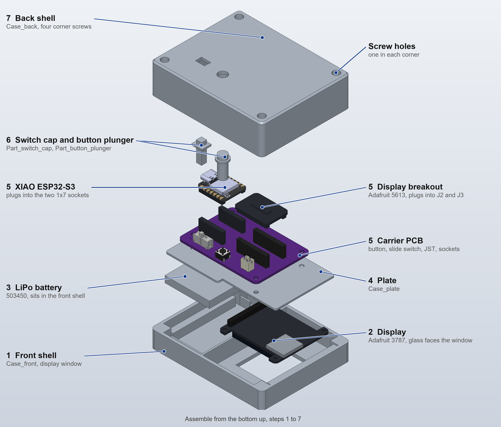

# Assembly and bring-up

Build the board, check it with a meter, load the firmware, then assemble the case. Do the meter checks before you connect the battery. A LiPo plugged in backwards can destroy the XIAO.

You need a soldering iron with a fine tip (320 to 350 C), 0.5 to 0.8 mm solder, flux, flush cutters, tweezers, solder wick, about 40 mm of 28 to 30 AWG wire, a multimeter with a continuity beep and a USB-C data cable. The parts are in [hardware/bom/BOM.md](../hardware/bom/BOM.md).

## 1. Solder the board

Hold the board with the USB-C end on the left, as in [hardware/pcb/renders/bare_top.png](../hardware/pcb/renders/bare_top.png). U1 is the XIAO, J2 and J3 are the display breakout sockets, SW1 is the button, SW2 is the slide switch, J1 is the battery connector and TP2 is the battery wire pad.

Heat the pad and pin together for 1 to 2 seconds, then touch the solder to the joint. Keep each joint under 4 seconds. For each row of pins, solder one pin at each end first and check the part sits flat.

1. Plug the XIAO into its two 1x7 sockets and solder the 2 x 7 male pins to it. The USB-C end faces the left edge and sticks out a little past it.
2. Take the flat cable out of the Adafruit 5613 breakout (lift the connector latch, pull the cable straight out). Plug the breakout into J2 and J3 and solder its 2 x 9 male pins. The printed side faces up with the Vin end at the right edge.
3. Turn the board over with both modules still plugged in. Rest it across two books so the modules hang free, then solder every socket pin from the back.
4. Pull both modules out, straight up.
5. Solder the button SW1. It fits one way.
6. Solder the slide switch SW2.
7. Test J1 before you solder it. Push it into the holes, plug the battery in and check that the red wire is on the same side as the + printed above J1. If not, unplug it, turn J1 around 180 degrees and check again. Confirm with the meter (check 0 below), then solder J1.
8. Solder R1 (0603, 0 ohm) next to J1. You can skip it: the backlight then stays at full brightness.
9. On the underside of the XIAO, between the D2 and D3 pins, there are two small rectangular pads. The lower one, marked + and BAT, is battery positive. The other is ground. Solder a stripped wire end to the + pad without touching the other pad. Plug the XIAO back in, push the free end through TP2 from the top, solder it and cut off the excess on the back. Leave a little slack.
10. Cut every leg on the back down to about 1 mm. The battery sits against this side.
11. Look at every joint. Each should be a small shiny cone. Remove bridges with solder wick.

## 2. Check the board

Meter on volts for check 0, then on continuity. J1 pin 1 (the + mark) is the left pin with the USB-C end on the left.

0. Battery polarity, before J1 is soldered. With the battery plugged into the loose J1, put the red probe on the pin tail under the + mark and the black probe on the other tail. You should read +3.6 to +4.2 V. A negative reading means the red wire is on the - pin, so turn J1 around. Below 3.3 V, charge the battery first. Below 3.0 V, do not use it. Unplug the battery.
1. With USB and battery unplugged, none of these should beep: J1 pin 1 to pin 2, XIAO 3V3 to GND, J2 pin 1 (Vin) to J2 pin 3 (GND), TP2 to GND. With the slide switch one way, TP2 to J1 pin 1 should beep. The other way it should not.
2. Switch off, battery unplugged, plug USB into a PC. The XIAO powers up. The voltage between its 3V3 and GND sockets should be 3.2 to 3.4 V.
3. Unplug USB, plug in the battery and switch on. The frame boots, and TP2 to GND reads 3.6 to 4.2 V. Switch off and it stops.
4. Switch on and plug in USB. The XIAO's charge LED lights. With the switch off the battery does not charge, because the switch cuts the battery wire.

## 3. Display and firmware

1. Plug the XIAO into U1 and the breakout into J2 and J3.
2. Connect the Adafruit 5462 cable between the display and the breakout. The contacts must face the connector contacts at both ends. A fold in the cable flips the contact side, so check which way it goes.
3. Set up and upload the firmware with [firmware/README.md](../firmware/README.md).
4. You should see the loading screen, then the first photo with the time at the top. The weather appears once Wi-Fi is connected.

## 4. Assemble the case

Print the five parts in [case/stl/](../case/stl/). You also need four M2.5 screws. The three test prints in `case/stl/test_prints/` let you check the display fit and the openings first.

1. Put the front shell face down on the table. The display window faces down.
2. Lay the display in the shell with the glass facing the window.
3. Put the battery in its pocket between the rails.
4. Lay the plate over the display and battery.
5. Place the board on the plate with the XIAO and breakout plugged in. Plug the display cable into the breakout and fold it around the board edge. Keep the bend at least 3 to 5 mm in radius, with no creases, and keep it from pulling on the connector latches. Plug the battery into J1 and check the polarity once more with the meter.
6. Put the switch cap on the slide switch lever and the plunger over the button.
7. Put the back shell on and close it with four M2.5 screws, one in each corner.

Then switch on and check the button, the slide switch, the USB-C opening and charging.

Do not squeeze, puncture or bend the LiPo. If it swells, gets hot or smells, unplug it and stop using it. Keep the unused pin strip on the display, if it is still fitted, away from the battery.
