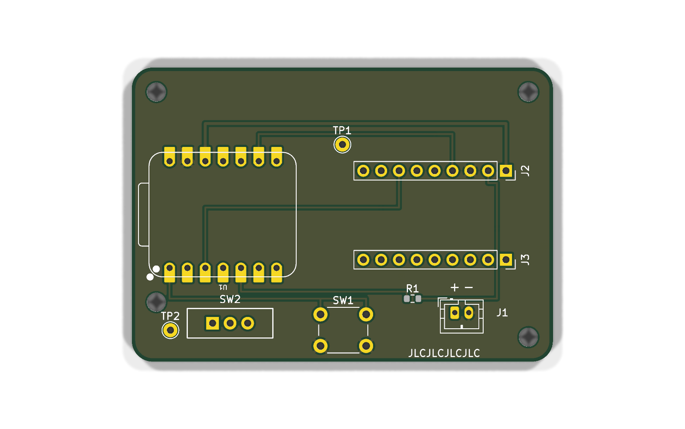
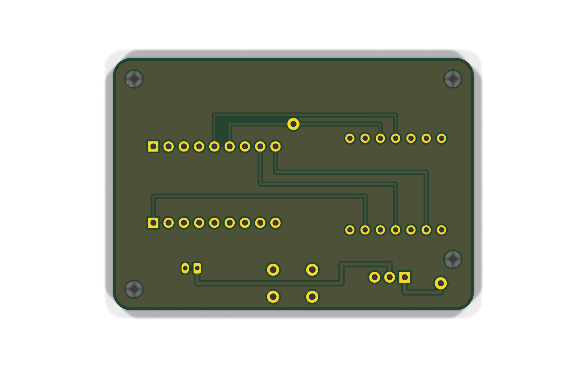
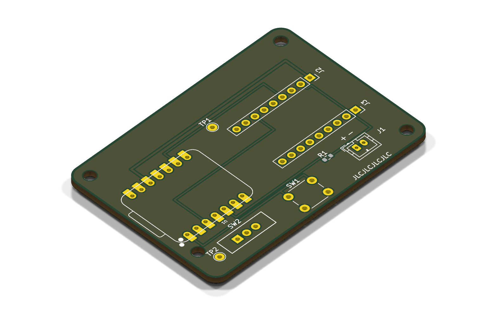
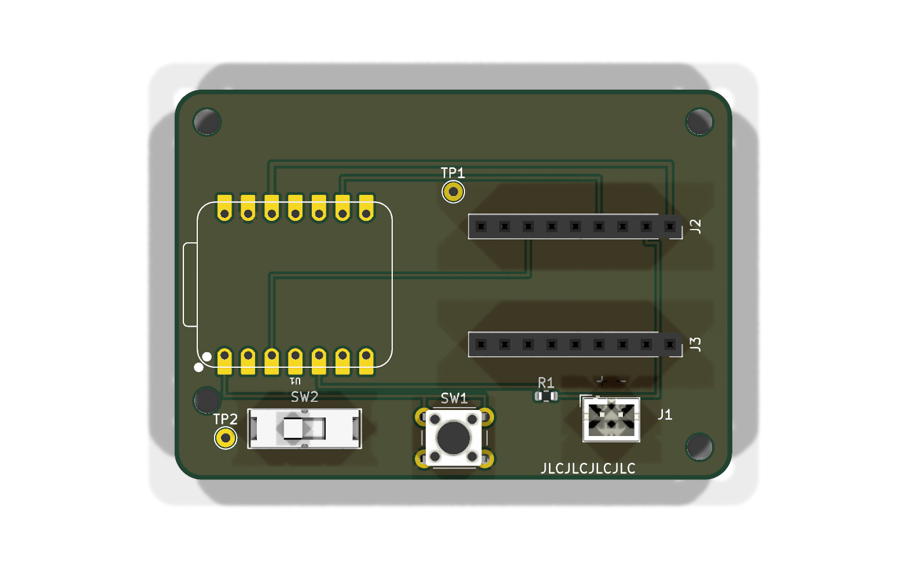
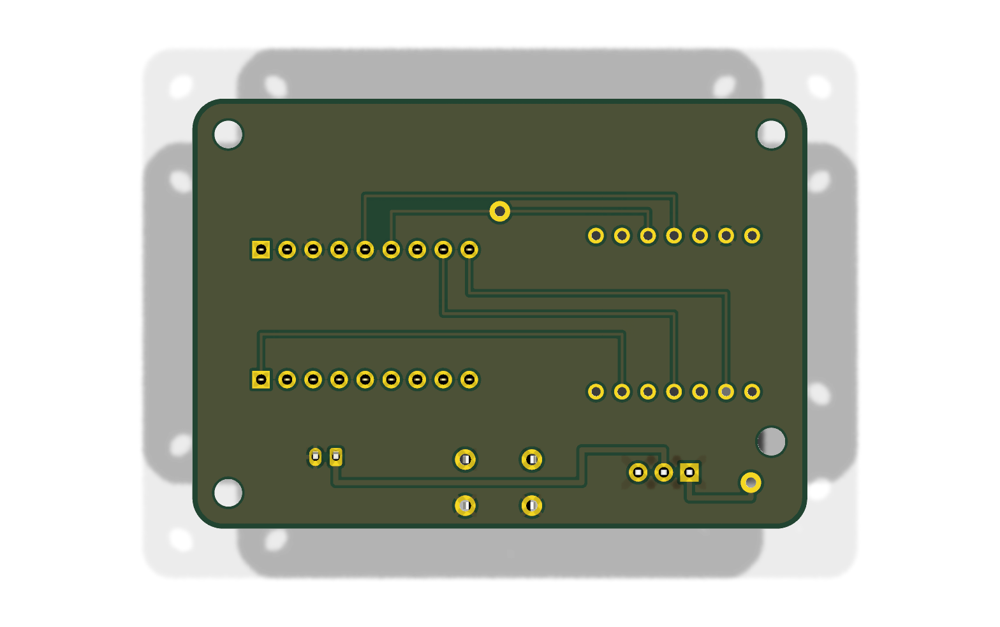
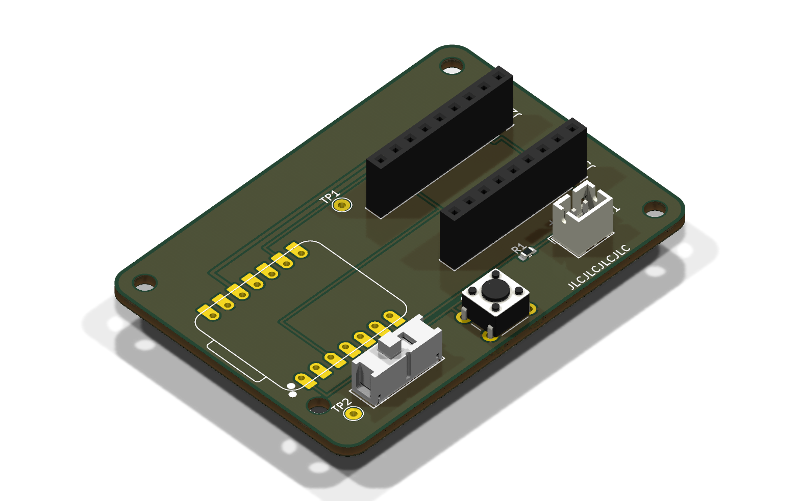

# Hardware

A 60 x 42 mm two-layer carrier board with rounded corners and four 2.7 mm holes for M2.5 screws. It holds the XIAO ESP32-S3 on two 1x7 sockets, the Adafruit EYE SPI breakout on two 1x9 sockets, one button, a slide switch in the battery line and a JST PH connector for the LiPo. The XIAO's USB-C port powers and charges the frame.

The KiCad 10 project is in [pcb/](pcb/). The XIAO symbol and footprint and the slide switch footprint are in `pcb/lib/`.

## Renders

| | Top | Bottom | Angle |
|---|---|---|---|
| Bare board |  |  |  |
| With parts |  |  |  |

The "with parts" renders show the parts soldered to the board: sockets J2 and J3, button, slide switch, JST connector and R1. The XIAO, its sockets and the display are not in these renders or in the STEP models. The labelled picture of every component is [docs/images/components-labelled.png](../docs/images/components-labelled.png).

## Files

| Path | Contents |
|---|---|
| `pcb/*.kicad_pro`, `.kicad_sch`, `.kicad_pcb` | KiCad project |
| `pcb/fab/jlcpcb_gerbers.zip` | Upload this to JLCPCB |
| `pcb/fab/gerbers/` | Full Gerber and drill set |
| `pcb/fab/PCB Photo Display.pdf` | Plot for checking |
| `pcb/fab/PCB Photo Display-drc.json` | DRC report |
| `pcb/3d/` | STEP models, bare and with parts |
| `pcb/renders/` | PNG renders |
| `bom/` | Bill of materials |

ERC reports 0 violations. DRC reports 0 errors, 0 unconnected items and 0 schematic differences. It has 15 warnings: 14 silkscreen over copper and 1 text height.

## Pins

| Signal | XIAO pin |
|---|---|
| SCK | D8 |
| MOSI | D10 |
| MISO (SD card only, also test pad TP1) | D9 |
| TFT CS | D1 |
| DC | D2 |
| RST | D3 |
| Backlight, through R1 | D4 |
| SD CS | D5 |
| Button to GND | D0 |
| Display power | 3V3 and GND |

## Power

- USB-C on the XIAO powers the frame and charges the battery.
- The LiPo plugs into J1, where pin 1 is +. The slide switch SW2 cuts the + battery wire. With USB plugged in the frame runs whatever the switch says, and the battery only charges with the switch on.
- One wire joins the XIAO's BAT+ pad (on its underside) to test pad TP2.
- The board cannot read the battery level or the charge state.

## Ordering

Upload `jlcpcb_gerbers.zip` to JLCPCB: 2 layers, 1.6 mm FR-4, lead-free HASL, quantity 5, no assembly. The silkscreen has a `JLCJLCJLCJLC` placeholder where JLCPCB prints its order number. Choose "specify a location" to keep it free. Check each part number in [bom/BOM.md](bom/BOM.md) with the supplier before ordering.
